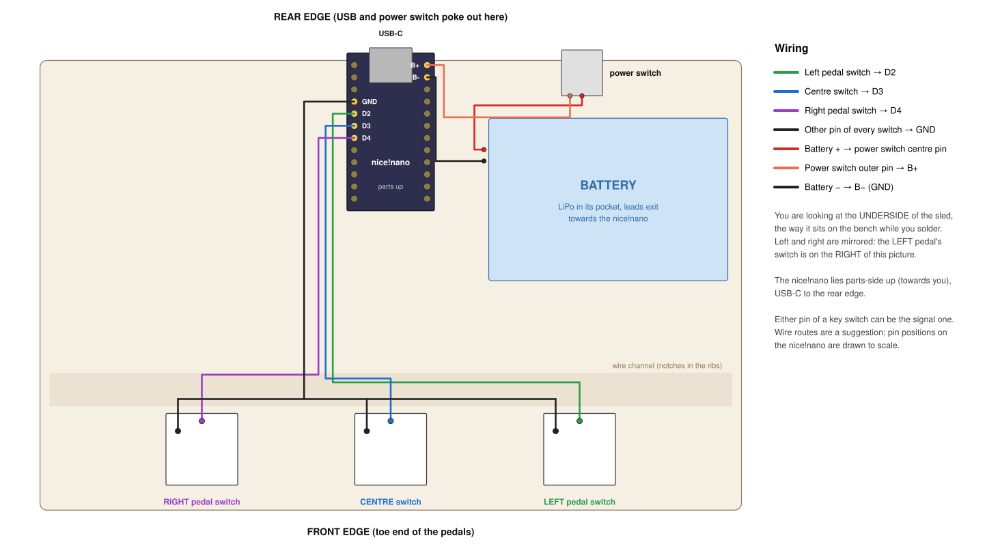

# PracticePedal

A 3D-printed Bluetooth page-turner pedal running [ZMK](https://zmk.dev) on a nice!nano.
Two pedals plus a raised centre key, 152 x 102 x 18.6 mm (the AirTurn PED 500 is 152 x 102 x 18).


| | |
|---|---|
| Size | 152 x 102 mm, 18.6 mm thick, centre key 7 mm proud |
| Keys | left pedal, right pedal, raised centre key (tap / double tap / hold) |
| Switches | 3x Kailh Choc v1, hand-wired, no PCB |
| Controller | nice!nano v2, USB-C at the back, slide power switch |
| Battery | LiPo up to 50 x 34 x 6 mm (503450, 1000 mAh) |
| Hardware | 6x M3x12 countersunk screws, 6x M3 heat-set inserts |
| Printed parts | 4, no supports |

## How it works


Front of the pedal is on the left. From the bottom up:

- **Tray**: floor and outer walls. The thick front wall is the down-stop the pedals land on.
- **Sled**: the switch plate. It also carries the nice!nano, battery and power switch, so all the
  wiring is on one part that you can test on the bench before closing the case.
- **Top**: one print containing both pedals and the centre key. Each key is cut free on three
  sides and stays attached at the back by a thinned strip that acts as a living hinge. There are
  no hinge pins or springs, and nothing to rattle.
- **Riser**: glued onto the centre key so it stands 7 mm above the pedals. You find it by feel and
  don't press it by accident.

Pressing a pedal rotates it about 2 degrees. The switch actuates at 1.5 mm of stem travel and the
pedal lands on the padded stop at 2.2 mm, before the switch bottoms out at 3.0 mm, so your foot
never loads the switch. If you stand on a pedal, ribs under it come down onto the sled 0.4 mm
later and carry the load into the floor.

The hinge supplies most of the return force (figures printed by the build, for PETG): about 230 gf
at the toe for the pedals and 180 gf for the centre key, plus the switch spring. Force goes with
the cube of `flex_t` / `center_flex_t` in `pedal_cad/params.py`, so 1.8 mm instead of 1.6 mm is
about 40 % firmer. PLA is about 65 % stiffer than PETG at the same thickness.

## Parts to buy

| Qty | Part | Notes |
|---|---|---|
| 1 | nice!nano v2 | no headers needed |
| 3 | Kailh Choc v1 switch | Linear and quiet suits a pedal: Red (50 gf) or Pro Red (35 gf). Avoid clicky ones. Choc v2 and MX do not fit. |
| 1 | LiPo cell with protection circuit, up to 50 x 34 x 6 mm | 503450 (1000 mAh) fills the pocket; anything smaller works with a bit of foam |
| 1 | SS12D00G3 mini slide switch | 8.7 mm body, 3 mm lever, 3 pins |
| 6 | M3 x 12 countersunk screw | |
| 6 | M3 heat-set insert, 4 to 5 mm long, about 4.6 to 5 mm OD | |
| 1 | Self-adhesive felt or foam strip, 1 mm thick, 5 mm wide, 135 mm long | pedal stop; makes the landing silent |
| 4 | 12 mm stick-on rubber feet | recesses on the bottom |
| | 26 to 28 AWG silicone wire, CA glue | |

## Printing

STL and STEP files are not committed. Get them from the latest run of the **Build CAD** workflow
on GitHub (Actions tab, `practice-pedal-cad` artifact), from a release, or build them yourself with
`uv run python -m pedal_cad.build`, which writes them to `out/stl/` and `out/step/`. STLs come out
already in print orientation.

| File | Orientation | Notes |
|---|---|---|
| `tray.stl` | as used | |
| `sled.stl` | upside down (switch plate on the bed) | |
| `top.stl` | upside down (top face on the bed) | a textured build plate gives the pedals a grippy surface |
| `riser.stl` | upside down | |

- **PETG is recommended**, at least for the top. The hinges flex on every press and PETG has much
  better fatigue life than PLA.
- 0.2 mm layers, 0.4 mm nozzle, 3 walls, no supports. Print the top with 100 % infill (it is
  mostly solid skin anyway).
- The hinges are the first 1.6 mm on the bed. Avoid elephant's foot compensation larger than
  0.2 mm, and check the 1 mm slots around the pedals are clear before assembly.

## Assembly

1. **Inserts.** Melt the six M3 inserts into the bosses on the underside of the top.
2. **Riser.** Glue the riser onto the centre key; its two pegs fit the two holes.
3. **Switches.** Clip the three Choc switches into the sled from the plate side.
4. **Flash first.** Plug the bare nice!nano into USB, double-tap RST to GND, and copy the
   firmware `.uf2` onto the drive that appears (see Firmware). This is easier now than later.
5. **nice!nano.** Turn the sled over. Lay the board in the centre window, components facing you
   and USB pointing at the rear edge, and slide it back under the four lips until the latch
   clicks up behind it. The board then sticks out about 2.5 mm past the rear of the sled. To
   remove it, press the latch bump in towards the plate with a small screwdriver and slide the
   board back out.
6. **Power switch.** Push the slide switch into its pocket with the lever through the slot. Fix
   it with a drop of CA glue or hot glue on the body.
7. **Wire it** (below), then put the battery in its pocket with the leads through the notch.
8. **Stop pad.** Stick the felt strip on top of the tray's raised front wall.
9. **Close up.** Lower the sled into the tray (USB and switch lever drop into their notches),
   put the top on, and drive the six screws in from below. Add the feet.

### Wiring



The diagram shows the sled from below, as you see it while soldering (rear edge at the top), so
left and right are mirrored: the left pedal's switch is on the right. To see the same thing in 3D,
run `uv run python -m pedal_cad.view sled nano battery power_switch choc_left choc_center choc_right`
and look from underneath. `out/drawings/sled_wiring_side.svg` is the plain outline version.
Every switch connects one pin to its nice!nano input and the other to ground; which pin is which
doesn't matter.

```
left pedal switch  ── D2  (P0.17)        battery +  ── slide switch (centre pin)
centre switch      ── D3  (P0.20)        slide switch (outer pin) ── B+ / RAW
right pedal switch ── D4  (P0.22)        battery -  ── B- / GND (next to RAW)
other pin of all three, chained ── GND
```

With the board face-up in the sled as in the drawing, D2/D3/D4 and their neighbouring GND pads
are on the left edge, and the battery pads are the first two on the right edge at the USB end.
The ribs have notches where the switch wires cross them.

## Firmware

The repository root is a standard ZMK config repo (ZMK v0.3):

- `boards/shields/practice_pedal/`: the shield (three direct-wired inputs)
- `config/practice_pedal.keymap`: what the keys do
- `config/practice_pedal.conf`: sleep and radio settings

Build it either way:

- **GitHub**: push the repo; the Actions workflow builds `practice_pedal` and `settings_reset`
  firmware as a downloadable artifact.
- **Locally**: `./scripts/build-firmware.sh` (needs podman or docker) writes
  `out/firmware/practice_pedal.uf2`.

### Default keymap

| Action | Sends |
|---|---|
| Left pedal | Page Up |
| Right pedal | Page Down |
| Centre tap | Play/Pause |
| Centre double tap | Previous track |
| Centre held + left / right | Volume down / up |
| **Both pedals held**, centre x1 | Next Bluetooth profile (5 available) |
| **Both pedals held**, centre x2 | Forget the pairing on this profile |
| **Both pedals held**, centre x3 | Enter the USB bootloader for re-flashing |

forScore, MobileSheets and most PDF readers turn pages on Page Up / Page Down out of the box.
Edit the keymap to send anything else; forScore can bind any key to any action.

Two side effects of the keymap to know about: a centre tap is sent about 0.3 s after you lift
your foot (it waits to see whether a second tap follows), and page turns are sent 40 ms after
the press (it waits to see whether the other pedal joins for the settings combo).

## Changing the design

Everything is parametric in `pedal_cad/params.py`.

```
uv run python -m pedal_cad.build
```

rebuilds all parts, re-exports `out/`, and runs fit checks: every part is a single solid, no two
parts overlap at rest, and each key can swing to its stop (and 0.3 mm beyond) without hitting
anything. It exits non-zero if a check fails.

### Viewing the model

With the OCP CAD Viewer extension open in VS Code:

```
uv run python -m pedal_cad.view                 # assembly at rest
uv run python -m pedal_cad.view exploded        # parts spread out
uv run python -m pedal_cad.view pressed left    # a key (left / center / right) at its stop
uv run python -m pedal_cad.view top sled        # only the named parts
```

The camera stays put between runs, so you can change a parameter, re-run, and compare. This
only builds the geometry; it skips the checks and doesn't write `out/`.

Parameters most likely to need a tweak:

| Parameter | Why |
|---|---|
| `nano_w`, `usb_overhang` | Vendors quote the nice!nano between 17.8 and 18.3 mm wide. Measure yours. |
| `psw_body_l`, `psw_body_t`, `psw_body_d` | SS12D00 clones vary by a few tenths. |
| `flex_t`, `center_flex_t` | Pedal force. |
| `stop_travel`, `stop_pad_t` | Where the pedal stops. Set `stop_pad_t = 0` if you skip the felt. |
| `stem_gap` | Free play before the pedal touches the switch. |
| `choc_cutout` | 13.9 mm; reduce to 13.8 if switches are loose in your printer's output. |

## Status

This is a first design that has not been printed yet. The geometry passes the interference checks
above, and the firmware compiles, but the hinge feel, the switch-pocket fit and the nice!nano
slide-in fit are calculated, not tested. Expect to tune a parameter or two after the first print.
